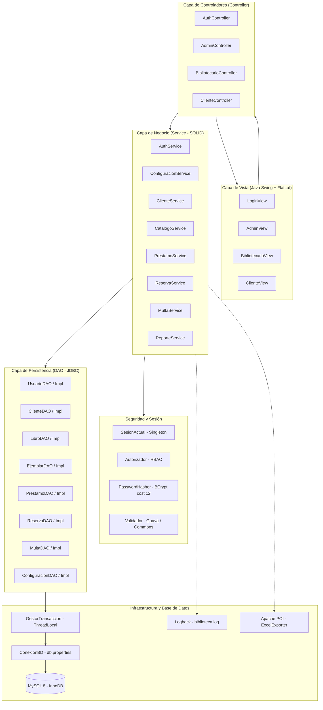

# Arquitectura del Sistema de Gestión de Biblioteca

El sistema está diseñado bajo una arquitectura multicapa desacoplada, fundamentada en los principios **SOLID**, el patrón **MVC (Modelo-Vista-Controlador)**, el patrón **DAO (Data Access Object)** y el enfoque de desarrollo **TDD (Test-Driven Development)** con control de seguridad transversal.

---

## 1. Diagrama de Arquitectura de Capas

---

## 2. Descripción de Componentes por Capa

### 2.1 Capa de Presentación (View)
- Implementada con componentes visuales nativos de **Java Swing** estilizados con **FlatLaf (FlatLightLaf)** para una interfaz moderna, limpia y sobria.
- Estricta separación de responsabilidades: las vistas únicamente capturan eventos de usuario y presentan modelos de datos (`DefaultTableModel`), sin albergar lógica de negocio ni cálculos financieros.
- Vistas divididas por rol:
  - `LoginView`: Formulario de acceso con control de bloqueo visual y redirección según rol.
  - `AdminView`: Panel con pestañas para bibliotecarios, catálogo, configuración global y exportación de reportes.
  - `BibliotecarioView`: Panel operacional con gestión de clientes, catálogo, préstamos, devoluciones, reservas y cobro de multas.
  - `ClienteView`: Catálogo de consulta y reserva, seguimiento de préstamos y vencimientos, consulta de multas y cambio de clave.

### 2.2 Capa de Controladores (Controller)
- Actúan como puente bidireccional entre la vista y los servicios de negocio.
- Capturan la entrada del usuario, delegan en la capa de servicio y transforman las respuestas o excepciones en actualizaciones de la interfaz gráfica a través de `ManejadorExcepciones`.

### 2.3 Capa de Servicios de Negocio (Service)
- Núcleo de las reglas del negocio de la biblioteca.
- Cumple con **SOLID**:
  - **Single Responsibility (SRP)**: Cada servicio gestiona un dominio específico (ej. `PrestamoService` para préstamos y devoluciones, `MultaService` para cálculo y cobranza).
  - **Open/Closed (OCP) & Liskov Substitution (LSP)**: Servicios extensibles mediante composición de interfaces.
  - **Interface Segregation (ISP)**: Cada DAO expone únicamente los métodos pertinentes a su entidad.
  - **Dependency Inversion (DIP)**: Los servicios reciben interfaces DAO en su constructor; nunca instancian directamente las implementaciones JDBC.
- Manejo transaccional: Las operaciones que modifican múltiples tablas (ej. `registrarPrestamo`, `registrarDevolucion`) se ejecutan atómicamente a través de `GestorTransaccion.ejecutar(...)`.

### 2.4 Capa de Persistencia (DAO)
- Implementada con JDBC puro sobre MySQL 8.
- **Seguridad**: Uso exclusivo de `PreparedStatement` con asignación de parámetros posicionales (`?`), imposibilitando ataques de inyección SQL (SQLi).
- Patrón try-with-resources para garantizar el cierre oportuno de `PreparedStatement` y `ResultSet`.
- Mapeo robusto a objetos de dominio y propagación de errores envueltos en `DaoException`.

---

## 3. Integración de las 4 Librerías de la Rúbrica

| Librería | Versión | Uso en el Sistema |
| :--- | :--- | :--- |
| **Google Guava** | `33.2.1-jre` | `Multimap` para agrupamiento en inventario (`ReporteService`), `Preconditions` y validaciones en capa de seguridad y servicios, `Stopwatch` para telemetría de exportación. |
| **Apache POI** | `5.2.5` | Generación de libros de trabajo `.xlsx` con estilos profesionales, formatos monetarios (`S/ #,##0.00`), fechas y totales automáticos (`ExcelExporter`). |
| **Apache Commons** | Lang3 `3.14.0` IO `2.16.1` | Validación de textos, nombres y correos con `StringUtils` y `Validate`; normalización y comprobación de rutas de archivos con `FilenameUtils`. |
| **Logback Classic** | `1.5.6` | Registro asíncrono y estructurado en consola y archivo rotativo diario (`logs/biblioteca.log`). Cero fuga de credenciales o hashes sensibles. |
