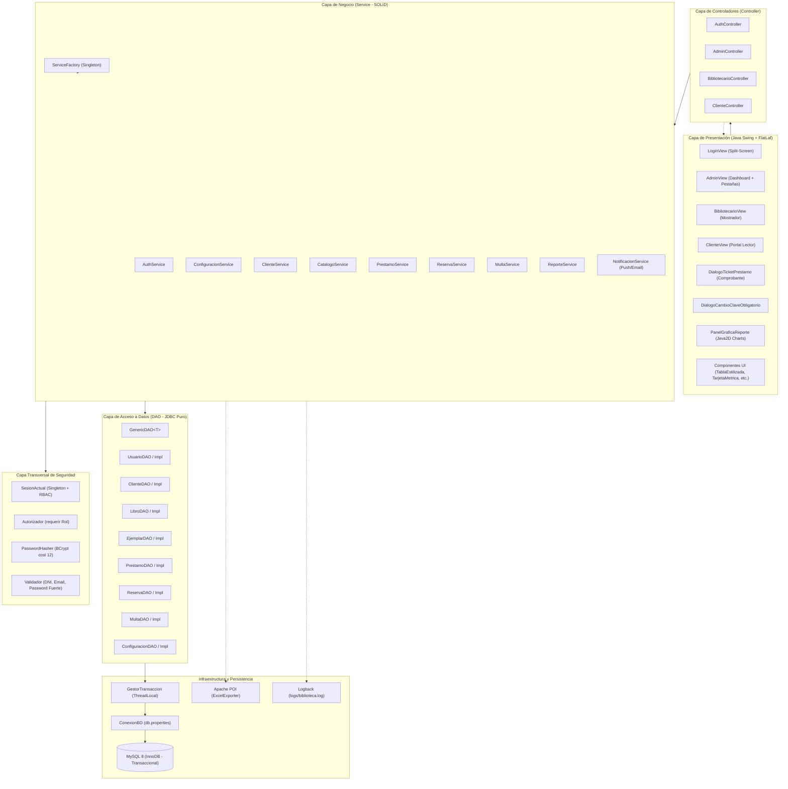
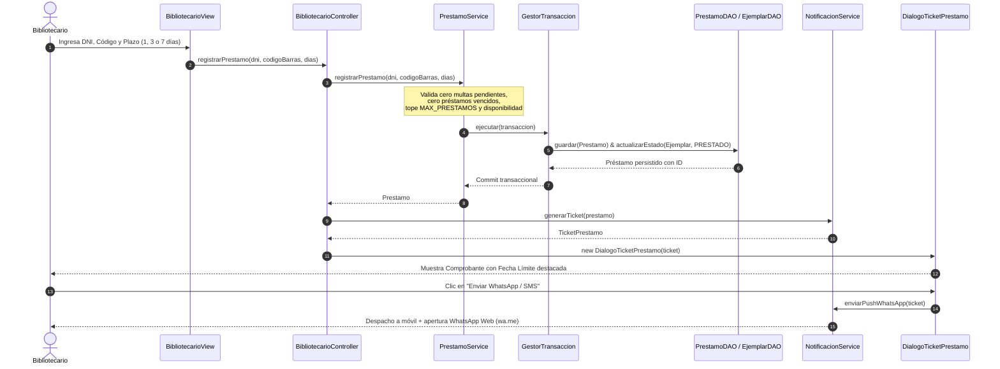

# Arquitectura del Sistema de Gestión de Biblioteca

El sistema está diseñado bajo una arquitectura multicapa desacoplada y modular, fundamentada en los principios **SOLID**, el patrón arquitectónico **MVC (Modelo-Vista-Controlador)**, el patrón **DAO (Data Access Object)**, **Service Layer** transaccional y el enfoque de desarrollo guiado por pruebas **TDD (Test-Driven Development)** con control de seguridad transversal basado en roles (RBAC).

---

## 1. Diagrama de Arquitectura de Capas (Mermaid)

---

## 2. Diagrama de Secuencia: Emisión de Préstamo y Notificación Push

---

## 3. Descripción Detallada de las Capas

### 3.1 Capa de Presentación (View)
- Desarrollada con **Java Swing** y tematizada con **FlatLaf (FlatLightLaf)** para una apariencia sobria, consistente y corporativa.
- **Ventanas Principales por Rol**:
  - [`LoginView`](file:///c:/Users/jerem/OneDrive/Desktop/BIBLIOTECA%20CI/src/main/java/com/biblioteca/view/LoginView.java): Pantalla dividida con panel corporativo a la izquierda y tarjeta central con layout estable de altura reservada contra parpadeos o desplazamientos.
  - [`AdminView`](file:///c:/Users/jerem/OneDrive/Desktop/BIBLIOTECA%20CI/src/main/java/com/biblioteca/view/AdminView.java): Panel de administración abierto en pantalla completa (`MAXIMIZED_BOTH`) con barra lateral, dashboard KPI, CRUD de bibliotecarios, catálogo bibliográfico colapsable con buscador en tiempo real, configuración del sistema y pestaña de reportes.
  - [`BibliotecarioView`](file:///c:/Users/jerem/OneDrive/Desktop/BIBLIOTECA%20CI/src/main/java/com/biblioteca/view/BibliotecarioView.java): Mostrador operativo con registro de clientes, emisión de préstamos con selector de plazo (1, 3 o 7 días), recepción de devoluciones con cálculo de mora, gestión de reservas FIFO y cobranza de multas.
  - [`ClienteView`](file:///c:/Users/jerem/OneDrive/Desktop/BIBLIOTECA%20CI/src/main/java/com/biblioteca/view/ClienteView.java): Portal del lector con catálogo navegable en cuadrícula o tabla, seguimiento de préstamos y vencimientos (destacados en color rojo), reservas activas y cambio seguro de contraseña.
- **Componentes Reutilizables** (`com.biblioteca.view.componentes`):
  - `PanelGraficaReporte`: Motor de renderizado Java2D para gráficos de barras verticales y horizontales, escalas con líneas guía punteadas, badges con valores, leyendas interactivas y tarjetas de métricas integradas.
  - `TablaEstilizada`: Renderer para filas alternadas, alturas de 32 px y chips de color para estados (`DISPONIBLE`, `PRESTADO`, `VENCIDO`, `PAGADA`, etc.).
  - `TarjetaMetrica`: Widgets para dashboards con iniciales, cifras destacadas y subtítulos.
  - `CampoTexto` y `CampoPassword`: Validación visual con bordes coloreados y botones de visibilidad de clave.
  - `DialogoTicketPrestamo`: Comprobante digital térmico con opciones de despacho push WhatsApp y correo.

### 3.2 Capa de Controladores (Controller)
- Siguen el patrón **MVC**: coordinan el flujo entre las vistas y los servicios de negocio sin contener reglas de negocio ni lógica SQL.
- Conectan eventos de interfaz (clicks, atajos de teclado) con llamadas a la capa de servicio y transforman excepciones controladas en diálogos visuales mediante `ManejadorExcepciones`.

### 3.3 Capa de Servicios de Negocio (Service)
- Núcleo operativo del sistema donde residen las reglas de negocio, validaciones y cálculos.
- **Principios SOLID aplicados**:
  - **S (Single Responsibility)**: Cada servicio gestiona estrictamente un dominio (ej. `PrestamoService` para préstamos y devoluciones, `MultaService` para mora, `NotificacionService` para tickets y despachos).
  - **O (Open/Closed)**: Ampliación de funcionalidades (como nuevos plazos de préstamo o nuevos tipos de exportación) mediante sobrecarga y polimorfismo sin modificar el código base probado.
  - **L (Liskov Substitution)**: Las implementaciones DAO son intercambiables respetando sus contratos genéricos.
  - **I (Interface Segregation)**: `GenericDAO<T>` define el CRUD base, mientras que métodos específicos (`buscarPorDni`, `listarColaPorLibro`) pertenecen únicamente a sus interfaces hijas.
  - **D (Dependency Inversion)**: Los servicios dependen de interfaces DAO inyectadas por constructor, orquestadas centralizadamente por `ServiceFactory`.
- **Transaccionalidad Atómica**:
  - Las operaciones que involucran múltiples escrituras se envuelven en `GestorTransaccion.ejecutar(...)`. Si cualquier paso falla, se ejecuta un `rollback` inmediato dejando la base de datos intacta.

### 3.4 Capa de Seguridad Transversal
- **Autenticación Robusta**:
  - Hashing criptográfico con **BCrypt (cost 12)** mediante `PasswordHasher`.
  - Mecanismo contra fuerza bruta: bloqueo temporal de 5 minutos al acumular 5 intentos fallidos consecutivos en `AuthService`.
  - Bandera `debe_cambiar_clave`: obliga a renovar contraseñas provisionales en el primer inicio de sesión.
- **Autorización Basada en Roles (RBAC)**:
  - `SesionActual`: Singleton que retiene el usuario en sesión activa.
  - `Autorizador.requerir(Rol...)`: Verifica privilegios al inicio de cada método de servicio sensible arrojando `AccesoDenegadoException` ante accesos no autorizados.
- **Validación de Entradas**:
  - `Validador`: Validación rigurosa de DNI (8 dígitos), contraseñas fuertes (mínimo 8 caracteres, al menos una mayúscula, minúscula y número), correo electrónico y teléfonos.

### 3.5 Capa de Acceso a Datos (DAO)
- Implementada con **JDBC puro sobre MySQL 8**:
  - **Seguridad**: Uso 100% estricto de `PreparedStatement` con parámetros vinculados (`?`), neutralizando vulnerabilidades de Inyección SQL (SQLi).
  - Cierre garantizado de conexiones, statements y result sets mediante `try-with-resources`.
  - Mapeo manual limpio de `ResultSet` a objetos de dominio.
  - Aislamiento de excepciones: `SQLException` se captura y envuelve en `DaoException` con registro en Logback a nivel `ERROR`, sin exponer trazas técnicas al usuario final.

---

## 4. Integración de las 4 Librerías Requeridas

| Librería | Coordenadas Maven | Propósito y Uso en la Arquitectura |
| :--- | :--- | :--- |
| **Google Guava** | `com.google.guava:guava:33.2.1-jre` | `Multimap` para agrupamiento de ejemplares en `ReporteService`, validación de precondiciones (`Preconditions`), y telemetría de tiempos de exportación con `Stopwatch`. |
| **Apache POI** | `org.apache.poi:poi-ooxml:5.2.5` | Generación de libros Excel `.xlsx` en `ExcelExporter` con encabezados estilizados, ajuste automático de columnas, y formatos de moneda (`S/ #,##0.00`) y fechas. |
| **Apache Commons** | `commons-lang3:3.14.0` `commons-io:2.16.1` | Validación y sanitización de cadenas con `StringUtils` y `Validate`; normalización segura de rutas de archivos de exportación con `FilenameUtils` y `FileUtils`. |
| **Logback Classic** | `ch.qos.logback:logback-classic:1.5.6` | Sistema de logging estructurado asíncrono sobre SLF4J, con rotación diaria de logs en `logs/biblioteca.log`, auditoría de logins, préstamos, devoluciones y cero fuga de contraseñas. |
