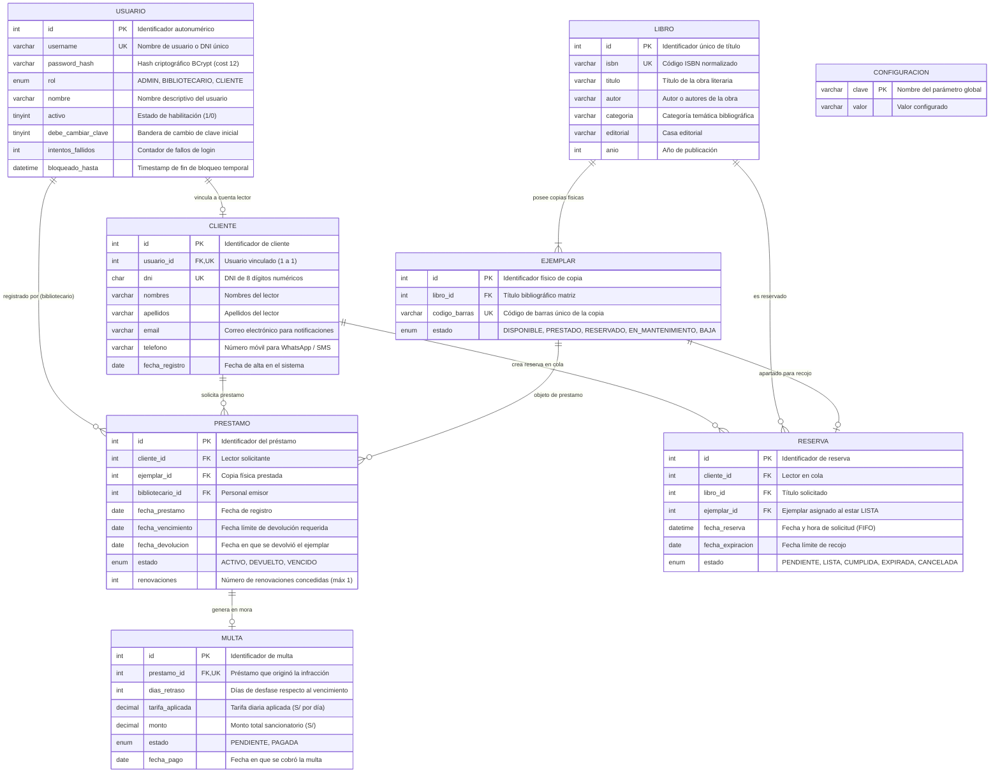

# Modelo de Datos del Sistema de Biblioteca

El sistema utiliza **MySQL 8** con motor de almacenamiento transaccional **InnoDB** y codificación de caracteres `utf8mb4_unicode_ci`. La integridad referencial se garantiza mediante claves primarias, claves foráneas, restricciones de unicidad (`UNIQUE`) e índices optimizados para consultas de alta concurrencia.

---

## 1. Diagrama Entidad-Relación (Mermaid)

---

## 2. Diccionario de Datos y Especificación de Tablas

### 2.1 Tabla `usuario`
Gestiona las credenciales de autenticación, roles de seguridad y políticas de control de acceso.
- `id`: `INT AUTO_INCREMENT PRIMARY KEY`.
- `username`: `VARCHAR(50) NOT NULL UNIQUE`.
- `password_hash`: `VARCHAR(100) NOT NULL` (almacena el hash seguro generado con BCrypt).
- `rol`: `ENUM('ADMIN', 'BIBLIOTECARIO', 'CLIENTE') NOT NULL`.
- `nombre`: `VARCHAR(120) NOT NULL`.
- `activo`: `TINYINT(1) NOT NULL DEFAULT 1`.
- `debe_cambiar_clave`: `TINYINT(1) NOT NULL DEFAULT 0`.
- `intentos_fallidos`: `INT NOT NULL DEFAULT 0`.
- `bloqueado_hasta`: `DATETIME NULL` (define la hora de desbloqueo tras 5 fallos consecutivos).

### 2.2 Tabla `cliente`
Almacena el perfil personal y datos de contacto de los lectores de la biblioteca.
- `id`: `INT AUTO_INCREMENT PRIMARY KEY`.
- `usuario_id`: `INT NOT NULL UNIQUE` (clave foránea vinculada a `usuario(id)`).
- `dni`: `CHAR(8) NOT NULL UNIQUE` (validado mediante expresión regular de 8 dígitos numéricos).
- `nombres`: `VARCHAR(80) NOT NULL`.
- `apellidos`: `VARCHAR(80) NOT NULL`.
- `email`: `VARCHAR(120) NULL` (usado para despacho de confirmaciones por correo electrónico).
- `telefono`: `VARCHAR(15) NULL` (usado para despacho de notificaciones Push vía WhatsApp / SMS).
- `fecha_registro`: `DATE NOT NULL DEFAULT (CURRENT_DATE)`.

### 2.3 Tabla `libro`
Almacena el catálogo de obras bibliográficas registradas.
- `id`: `INT AUTO_INCREMENT PRIMARY KEY`.
- `isbn`: `VARCHAR(20) NOT NULL UNIQUE`.
- `titulo`: `VARCHAR(200) NOT NULL`.
- `autor`: `VARCHAR(150) NOT NULL`.
- `categoria`: `VARCHAR(80) NOT NULL`.
- `editorial`: `VARCHAR(100) NOT NULL`.
- `anio`: `INT NOT NULL`.
- *Índices*: `INDEX idx_libro_categoria (categoria)`, `INDEX idx_libro_titulo (titulo)`.

### 2.4 Tabla `ejemplar`
Representa cada una de las copias físicas tangibles de un libro que circulan en estantería.
- `id`: `INT AUTO_INCREMENT PRIMARY KEY`.
- `libro_id`: `INT NOT NULL` (clave foránea vinculada a `libro(id)` con `ON DELETE CASCADE`).
- `codigo_barras`: `VARCHAR(30) NOT NULL UNIQUE` (código de identificación patrimonial, ej. `L0001-001`).
- `estado`: `ENUM('DISPONIBLE', 'PRESTADO', 'RESERVADO', 'EN_MANTENIMIENTO', 'BAJA') NOT NULL DEFAULT 'DISPONIBLE'`.
- *Índices*: `INDEX idx_ejemplar_estado (estado)`.

### 2.5 Tabla `prestamo`
Registra el ciclo de vida de los préstamos de libros otorgados a los lectores.
- `id`: `INT AUTO_INCREMENT PRIMARY KEY`.
- `cliente_id`: `INT NOT NULL` (clave foránea a `cliente(id)`).
- `ejemplar_id`: `INT NOT NULL` (clave foránea a `ejemplar(id)`).
- `bibliotecario_id`: `INT NOT NULL` (clave foránea a `usuario(id)`).
- `fecha_prestamo`: `DATE NOT NULL`.
- `fecha_vencimiento`: `DATE NOT NULL` (calculada según el plazo concedido de 1, 3 o 7 días).
- `fecha_devolucion`: `DATE NULL` (registrada al devolver el ejemplar).
- `estado`: `ENUM('ACTIVO', 'DEVUELTO', 'VENCIDO') NOT NULL DEFAULT 'ACTIVO'`.
- `renovaciones`: `INT NOT NULL DEFAULT 0` (máximo permitido: 1).
- *Índices*: `INDEX idx_prestamo_vencimiento (fecha_vencimiento, estado)`, `INDEX idx_prestamo_cliente (cliente_id)`.

### 2.6 Tabla `reserva`
Implementa la cola de espera FIFO por título cuando no hay stock físico disponible.
- `id`: `INT AUTO_INCREMENT PRIMARY KEY`.
- `cliente_id`: `INT NOT NULL` (clave foránea a `cliente(id)`).
- `libro_id`: `INT NOT NULL` (clave foránea a `libro(id)`).
- `ejemplar_id`: `INT NULL` (clave foránea a `ejemplar(id)`, asignado cuando pasa a estado `LISTA`).
- `fecha_reserva`: `DATETIME NOT NULL DEFAULT CURRENT_TIMESTAMP` (garantiza el orden FIFO de llegada).
- `fecha_expiracion`: `DATE NULL` (plazo límite para que el lector recoja su copia).
- `estado`: `ENUM('PENDIENTE', 'LISTA', 'CUMPLIDA', 'EXPIRADA', 'CANCELADA') NOT NULL DEFAULT 'PENDIENTE'`.
- *Índices*: `INDEX idx_reserva_cola (libro_id, estado, fecha_reserva)`.

### 2.7 Tabla `multa`
Registra sanciones pecuniarias generadas automáticamente cuando un ejemplar se devuelve fuera de plazo.
- `id`: `INT AUTO_INCREMENT PRIMARY KEY`.
- `prestamo_id`: `INT NOT NULL UNIQUE` (clave foránea a `prestamo(id)`).
- `dias_retraso`: `INT NOT NULL` (días naturales transcurridos entre la fecha de vencimiento y la devolución).
- `tarifa_aplicada`: `DECIMAL(10,2) NOT NULL` (tarifa diaria histórica vigente en el momento de la devolución).
- `monto`: `DECIMAL(10,2) NOT NULL` (producto de `dias_retraso * tarifa_aplicada`).
- `estado`: `ENUM('PENDIENTE', 'PAGADA') NOT NULL DEFAULT 'PENDIENTE'`.
- `fecha_pago`: `DATE NULL` (timestamp en el que el bibliotecario efectúa el cobro).
- *Índices*: `INDEX idx_multa_estado (estado)`.

### 2.8 Tabla `configuracion`
Almacén clave-valor para parámetros operativos globales editables por el Administrador:
- `clave`: `VARCHAR(50) NOT NULL PRIMARY KEY`.
- `valor`: `VARCHAR(100) NOT NULL`.

| Clave | Valor Inicial | Descripción Funcional |
| :--- | :---: | :--- |
| `MULTA_POR_DIA` | `1.00` | Tarifa monetaria en Soles (S/) aplicada por cada día de mora. |
| `DIAS_PRESTAMO` | `7` | Duración estándar en días naturales asignada al emitir o renovar un préstamo. |
| `MAX_PRESTAMOS` | `3` | Cantidad máxima de préstamos simultáneos en estado `ACTIVO` que un cliente puede tener. |
| `DIAS_RETENCION_RESERVA` | `3` | Días de espera que se retiene un ejemplar `LISTA` para recojo antes de expirar. |

---

## 3. Modelos de Dominio en Memoria (DTOs)

Además de las entidades persistidas, el sistema utiliza modelos de transferencia de datos para operaciones complejas:

- **`TicketPrestamo`** (`com.biblioteca.model.TicketPrestamo`):
  Consolida en un solo objeto los datos del préstamo (`id`, `fechaPrestamo`, `fechaVencimiento`, `diasOtorgados`), del lector (`clienteNombre`, `clienteDni`, `clienteTelefono`, `clienteEmail`), de la obra (`libroTitulo`, `libroAutor`, `codigoBarras`) y de la política (`tarifaMultaPorDia`). Es utilizado por `NotificacionService` y `DialogoTicketPrestamo` para imprimir comprobantes y despachar notificaciones Push y correo.
- **`ResultadoDevolucion`** (`com.biblioteca.model.ResultadoDevolucion`):
  Objeto inmutable que encapsula el resultado de procesar una devolución: días de retraso, monto de multa calculada, nuevo estado del ejemplar y mensaje de alerta para el bibliotecario.
